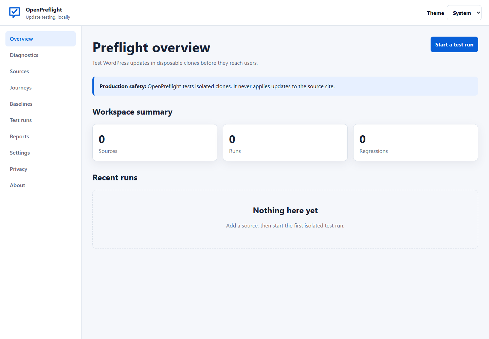
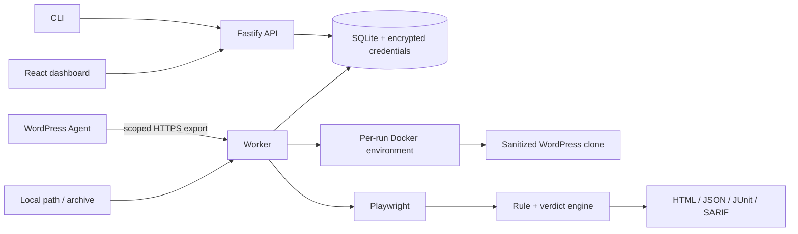

# OpenPreflight

> **Test every WordPress update before your users do.**

OpenPreflight is a self-hosted update preflight system. It copies a WordPress
site into a disposable Docker environment, sanitizes the clone, records a
baseline, applies selected core/plugin/theme updates only to the candidate,
runs Playwright journeys, and produces explainable HTML, JSON, JUnit, and SARIF
reports. It has no hosted-service requirement, telemetry, analytics, or public
sharing feature.

> [!WARNING]
> OpenPreflight v1 tests isolated clones. It cannot apply updates to production.
> Clones can still contain personal data and unknown plugin secrets; treat all
> source exports and artifacts as sensitive.

## Project status

Version 1.0.0 is under release-candidate verification. Core implementation is
present, but publication is blocked until the owner metadata placeholders are
replaced and the complete clean-room matrix in `VERIFICATION.md` passes. No
badge is shown before its corresponding public workflow is configured.



_The real bundled dashboard, captured by `scripts/capture-dashboard.ts` against the local API._

## What it checks

- HTTP, PHP fatal/parse/exception, WordPress debug/database/REST/cron failures
- browser console, page, AJAX, REST, redirect, and failed/external requests
- resilient functional journeys for WordPress and WooCommerce
- pixel visual changes with masks, diffs, overlays, and compatibility metadata
- axe-core accessibility findings plus keyboard/focus workflow assertions
- lab performance budgets and baseline-relative regressions
- missing cart fragments, shipping/payment methods, and blocked email/payment calls
- deterministic finding states and policy-driven pass/warn/fail verdicts

## Sixty-second quick start

Requirements: Node.js 24 LTS, pnpm 11 through Corepack, Docker Engine/Desktop
with Compose v2, 8 GiB RAM, and 10 GiB free disk. PHP 8.1+ and Composer 2 are
needed for Agent development.

```bash
git clone https://REPLACE_BEFORE_RELEASE.invalid/openpreflight.git
cd openpreflight
cp .env.example .env
corepack enable
pnpm install --frozen-lockfile
docker compose up -d
pnpm openpreflight doctor
pnpm openpreflight init
pnpm openpreflight source add --type local --path /path/to/wordpress --name "Example Store"
pnpm openpreflight run --source SOURCE_ID --updates all
pnpm openpreflight report open latest
```

Native Windows is supported with Docker Desktop and pnpm commands; WSL2 is
recommended for the full Unix Make workflow. Linux x86-64 is the release-image
target. macOS with Docker Desktop is supported for local development.

## Demo

The demo downloads only public WordPress/WooCommerce components, creates fresh
local data, and never needs a paid service or secret:

```bash
pnpm demo
# or: make demo
```

An exit code of `1` is the expected successful demo outcome: reproducible
regressions were found. Artifacts are printed and retained under
`.openpreflight/runs/<run-id>/reports/`.

Example result:

```text
OpenPreflight Run: FAILED
✓ Homepage returned HTTP 200
✗ Fixture request returned HTTP 500
✗ JavaScript console error was introduced
✗ Automated accessibility violations were introduced
⚠ Homepage visual difference exceeded its threshold
Verdict: FAIL — do not install this update in production.
```

## Architecture



The control-plane worker may access Docker to create jobs; cloned WordPress,
database, mail, browser, and egress containers never receive the Docker socket.
Each job receives its own network, database, filesystem, browser contexts, and
bounded artifacts. See [architecture overview](docs/architecture/overview.md)
and [threat model](docs/security/threat-model.md).

## CLI basics

```bash
pnpm openpreflight --help
pnpm openpreflight source list --json
pnpm openpreflight journey validate examples/journeys/homepage.yaml
pnpm openpreflight baseline create --source SOURCE_ID
pnpm openpreflight run --source SOURCE_ID --update file:/legal/update.zip
pnpm openpreflight run status RUN_ID
pnpm openpreflight cleanup --older-than 7d
```

Exit codes are stable: `0` pass, `1` regressions, `2` input/configuration,
`3` infrastructure, `4` authentication, and `5` cancellation.

## Journey example

```yaml
schemaVersion: '1.0'
id: homepage
name: Homepage
steps:
  - visit: { path: / }
  - expect: { target: { css: body }, state: visible }
  - assertNoConsoleErrors: true
  - assertNoFailedRequests: true
  - screenshot: { name: homepage, fullPage: true }
```

Ordinary journeys cannot run arbitrary JavaScript. Variables and secrets are
separate; secret values come from environment variables and are redacted before
logs or reports are persisted.

## Reports and baselines

Reports compare candidate observations against the same sanitized baseline.
Only new or changed errors fail by default; unchanged existing problems remain
visible and resolved findings are highlighted. Infrastructure errors produce an
`ERROR` run, not a false regression. Automated accessibility output never
claims WCAG conformance, and lab performance is not real-user monitoring.

## Security and privacy

OpenPreflight defaults to loopback binding, restricted egress, blocked mail,
disabled production payment/webhook integrations, scoped Agent tokens, safe
archive extraction, encrypted local credentials, bounded resources, local-only
artifacts, no telemetry, and no third-party UI assets. This reduces risk but
cannot make arbitrary cloned plugin code safe. Read the
[security model](docs/security/threat-model.md), [privacy guide](docs/security/privacy.md),
and [responsible disclosure policy](SECURITY.md) before use.

## Limitations

- WordPress multisite is detected but unsupported in v1.0.
- Premium packages must be legally supplied locally or retrieved by an already-authorized clone without exporting credentials.
- No real orders, payment transactions, emails, production updates, Kubernetes, distributed workers, or hosted SaaS.
- Docker isolation is defense in depth, not a guarantee against kernel/container escapes.
- Automated accessibility testing still requires manual review.

## Development

```bash
pnpm lint
pnpm typecheck
pnpm test
pnpm integration
pnpm e2e
composer check
pnpm build
pnpm package
```

See [CONTRIBUTING.md](CONTRIBUTING.md), the [development setup](docs/development/setup.md),
[Code of Conduct](CODE_OF_CONDUCT.md), [security policy](SECURITY.md), and
[roadmap](ROADMAP.md).

## License and maintainers

Copyright OpenPreflight contributors. Licensed under
[GPL-2.0-or-later](LICENSE). Maintainer and repository coordinates are listed in
[MAINTAINERS.md](MAINTAINERS.md) and must be finalized before publication.

## Acknowledgements

OpenPreflight builds on WordPress, WooCommerce, WP-CLI, Playwright, axe-core,
Fastify, React, SQLite, Docker, and the wider open-source security ecosystem.
