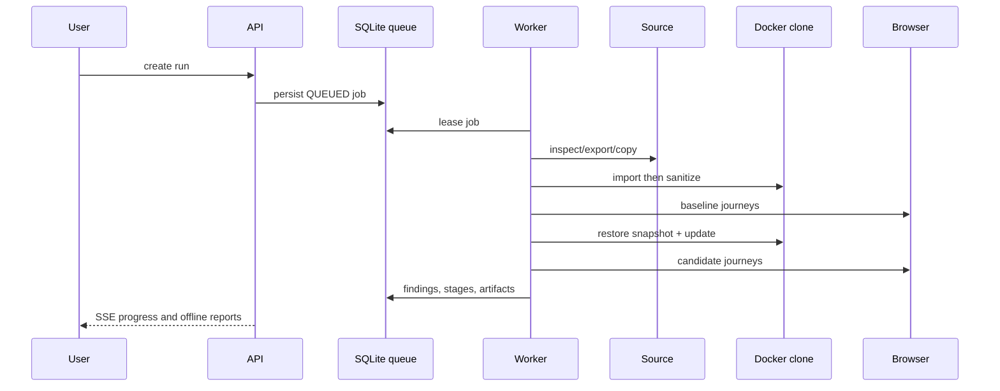

# Data flow

Raw Agent archives are deleted immediately after verified import unless explicit
retention is enabled. Logs/evidence are redacted before storage. Reports never
leave the host automatically.
